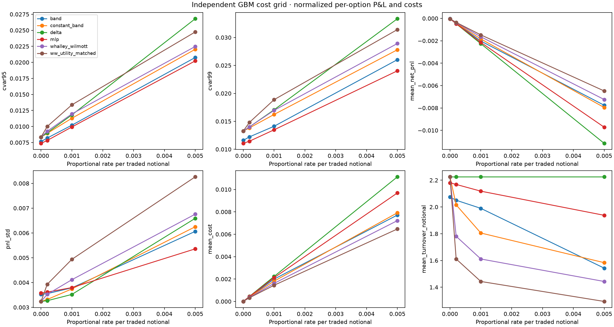
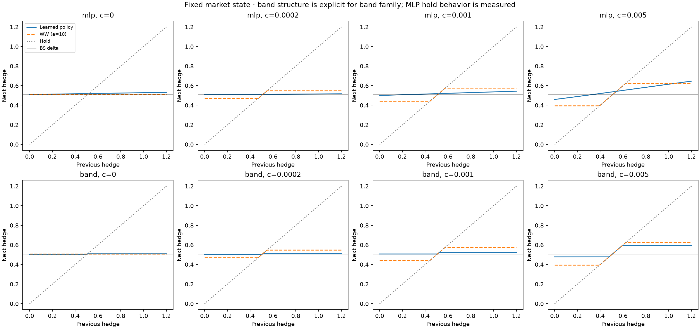
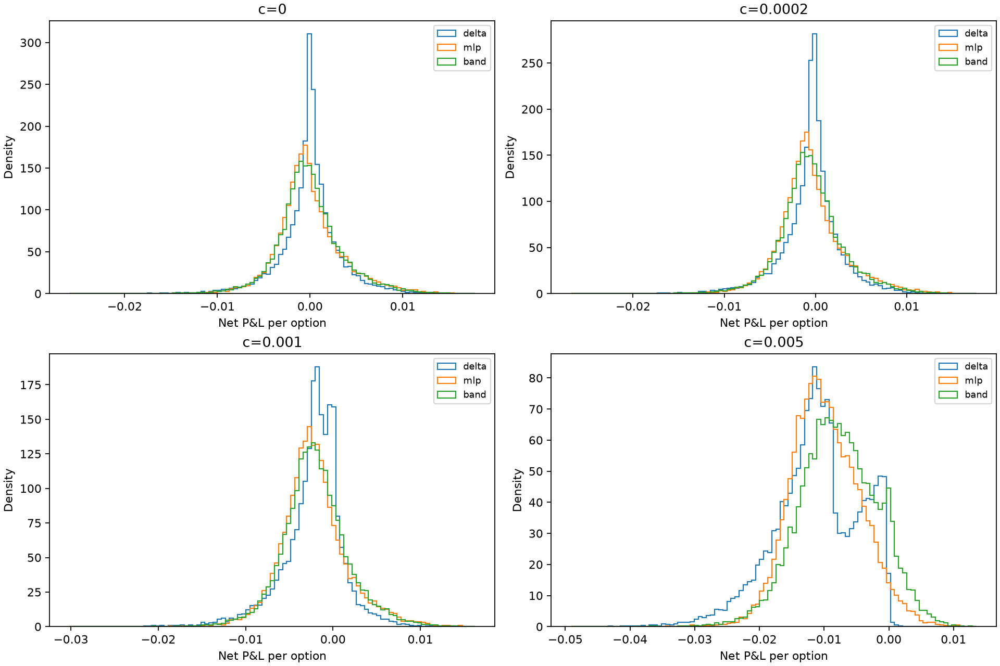
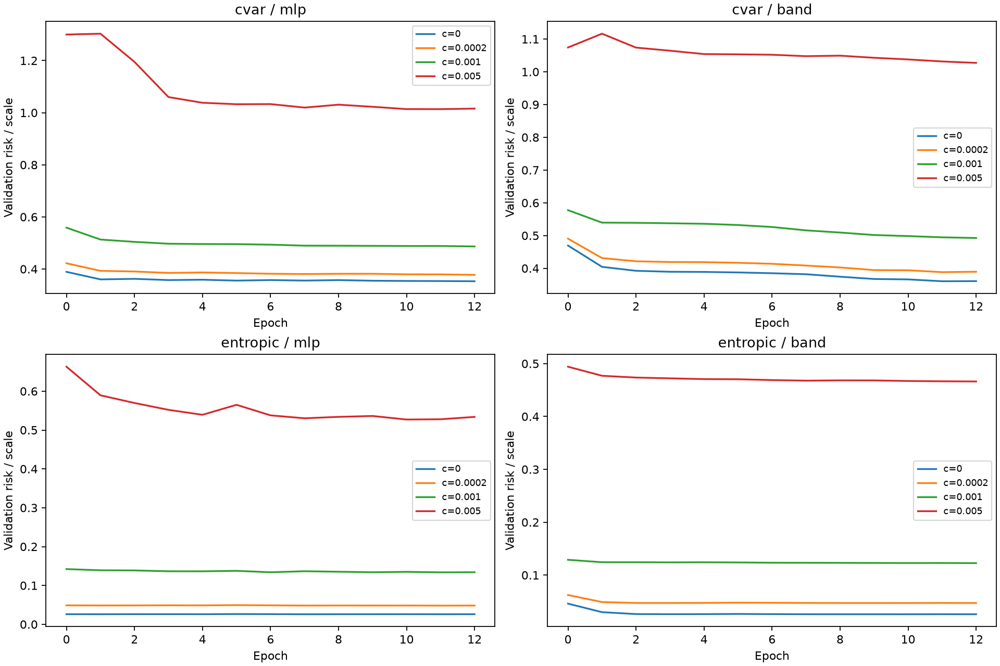

# Minimum viable continuous deep-hedging research project

Phases 0a–4: accounting and frictionless validation foundations, followed by a frozen cost experiment. This report is synthetic research, not market returns.

## Experiment contract

Short one European call/put to expiry; zero drift/rates; normalized strike 1; 32 trading intervals over 20/252 years; initial spot 0.9–1.1 and sigma 0.15–0.30. Premium and terminal liability are identical for all strategies on each path. Opening and final hedge liquidation costs are included.

Four proportional rates: 0, 0.0002, 0.001, 0.005. MLP and explicit learned-band policies use CVaR95 and entropic objectives, three seeds each. Adam training uses fresh paths. Baseline and checkpoint choices use validation only; all weights were frozen before generating test simulations.

There are 16,384 unique primary test paths, reused across cost cases for pairing; they are not 65,536 independent market histories. All seed results, objective-specific baseline searches, hashes and curves are retained. Paired path-bootstrap intervals condition on this GBM specification.

## Central results

| cost | label | mean_net_pnl | pnl_std | cvar95 | cvar99 | mean_cost | mean_turnover_notional |
|---|---|---|---|---|---|---|---|
| 0 | unhedged | 0.000203149 | 0.0401158 | 0.110103 | 0.162752 | 0 | 0 |
| 0 | delta | -3.49272e-05 | 0.00323822 | 0.00834456 | 0.0132499 | 0 | 2.22532 |
| 0 | constant_band | -3.49272e-05 | 0.00323822 | 0.00834456 | 0.0132499 | 0 | 2.22532 |
| 0 | whalley_wilmott | -3.49272e-05 | 0.00323822 | 0.00834456 | 0.0132499 | 0 | 2.22532 |
| 0 | ww_utility_matched | -3.49272e-05 | 0.00323822 | 0.00834456 | 0.0132499 | 0 | 2.22532 |
| 0 | mlp | -3.62543e-05 | 0.00357505 | 0.00737287 | 0.0110642 | 0 | 2.18058 |
| 0 | band | -3.07206e-05 | 0.00352297 | 0.00764135 | 0.0115975 | 0 | 2.07407 |
| 0.0002 | unhedged | 0.000203149 | 0.0401158 | 0.110103 | 0.162752 | 0 | 0 |
| 0.0002 | delta | -0.00047999 | 0.0032682 | 0.00901844 | 0.013998 | 0.000445063 | 2.22532 |
| 0.0002 | constant_band | -0.000436305 | 0.00331713 | 0.00892942 | 0.0138192 | 0.000403117 | 2.01559 |
| 0.0002 | whalley_wilmott | -0.00038424 | 0.00352457 | 0.00925851 | 0.013999 | 0.000356171 | 1.78085 |
| 0.0002 | ww_utility_matched | -0.00035526 | 0.00392938 | 0.0100028 | 0.0148026 | 0.000322253 | 1.61127 |
| 0.0002 | mlp | -0.000468605 | 0.00361423 | 0.00782412 | 0.0114415 | 0.000433716 | 2.16858 |
| 0.0002 | band | -0.000440717 | 0.00355357 | 0.00820163 | 0.0122138 | 0.000410066 | 2.05033 |
| 0.001 | unhedged | 0.000203149 | 0.0401158 | 0.110103 | 0.162752 | 0 | 0 |
| 0.001 | delta | -0.00226024 | 0.00352087 | 0.0118086 | 0.0170594 | 0.00222532 | 2.22532 |
| 0.001 | constant_band | -0.00183608 | 0.00374348 | 0.0112876 | 0.016224 | 0.00180541 | 1.80541 |
| 0.001 | whalley_wilmott | -0.00164427 | 0.00411538 | 0.0119603 | 0.0169586 | 0.00161127 | 1.61127 |
| 0.001 | ww_utility_matched | -0.00147331 | 0.0049369 | 0.0133769 | 0.0188693 | 0.00144321 | 1.44321 |
| 0.001 | mlp | -0.00215066 | 0.00379658 | 0.00992573 | 0.0134809 | 0.00211821 | 2.11821 |
| 0.001 | band | -0.00202286 | 0.00378606 | 0.0102044 | 0.0141107 | 0.00198975 | 1.98975 |
| 0.005 | unhedged | 0.000203149 | 0.0401158 | 0.110103 | 0.162752 | 0 | 0 |
| 0.005 | delta | -0.0111615 | 0.00658943 | 0.0268032 | 0.0333517 | 0.0111266 | 2.22532 |
| 0.005 | constant_band | -0.00795824 | 0.00624949 | 0.0220361 | 0.0278023 | 0.0079192 | 1.58384 |
| 0.005 | whalley_wilmott | -0.00724614 | 0.00675786 | 0.0224759 | 0.0289221 | 0.00721603 | 1.44321 |
| 0.005 | ww_utility_matched | -0.00648207 | 0.00826309 | 0.0247407 | 0.0314148 | 0.00646979 | 1.29396 |
| 0.005 | mlp | -0.00971784 | 0.00535834 | 0.0202293 | 0.0240348 | 0.00968914 | 1.93783 |
| 0.005 | band | -0.00775879 | 0.00606394 | 0.0207587 | 0.0260309 | 0.00771495 | 1.54299 |

## Inventory response and no-trade interpretation

The band family explicitly projects inventory into learned market-state bounds. Its no-trade structure is an architectural assumption, not proof that an unconstrained MLP discovered a band. The MLP is evaluated both for exact holds (1e-6 tolerance) and an approximate operational hold region (0.005 underlying units). Width growth is measured and may fail monotonicity; it is not an acceptance criterion. The diagnostic uses S=K=1, sigma=0.2, half remaining maturity and a call. WW curves use validation-selected coefficients and remain a small-cost exponential-utility benchmark rather than a universal CVaR optimum.

| cost | family | exact_hold_width | approximate_hold_width |
|---|---|---|---|
| 0 | mlp | 0 | 0.00800002 |
| 0 | band | 0.00400001 | 0.016 |
| 0.0002 | mlp | 0 | 0.00800002 |
| 0.0002 | band | 0.00800002 | 0.016 |
| 0.001 | mlp | 0 | 0.00800002 |
| 0.001 | band | 0.014 | 0.022 |
| 0.005 | mlp | 0 | 0.00999999 |
| 0.005 | band | 0.116 | 0.124 |

## P&L distributions and training

## Uncertainty and interpretation

| cost | family | mean_pnl_difference | lower95 | upper95 | cvar95_difference | cvar95_lower95 | cvar95_upper95 |
|---|---|---|---|---|---|---|---|
| 0 | mlp | -1.32706e-06 | -2.35064e-05 | 2.33595e-05 | -0.000971691 | -0.00109247 | -0.000843622 |
| 0 | band | 4.2066e-06 | -1.7394e-05 | 2.59869e-05 | -0.000703207 | -0.000813632 | -0.000595626 |
| 0.0002 | mlp | 1.13855e-05 | -1.34646e-05 | 3.851e-05 | -0.00119433 | -0.00133034 | -0.00105091 |
| 0.0002 | band | 3.92729e-05 | 1.54822e-05 | 6.32744e-05 | -0.000816819 | -0.000933027 | -0.000705201 |
| 0.001 | mlp | 0.00010958 | 7.53493e-05 | 0.000147098 | -0.00188289 | -0.00205102 | -0.00169818 |
| 0.001 | band | 0.000237387 | 0.000205426 | 0.000271455 | -0.0016042 | -0.0017457 | -0.00145376 |
| 0.005 | mlp | 0.00144366 | 0.00136057 | 0.00153136 | -0.00657389 | -0.00687025 | -0.0062589 |
| 0.005 | band | 0.00340271 | 0.00332011 | 0.00348233 | -0.00604448 | -0.00634574 | -0.00571637 |

Lower loss CVaR is better, higher mean P&L is better. Objectives can trade lower tail losses against larger overall dispersion or costs. Neither a favorable point estimate nor a monotone width chart proves a real-market advantage. Seed variation is saved separately from path-bootstrap uncertainty.

## MVP gate and limits

Independent zero-cost MLP gates: [{'objective': 'cvar', 'passed': True}, {'objective': 'entropic', 'passed': True}]

Prior phases independently verified cash reconciliation, future-perturbation causality, gradients, pricing and frictionless numerical tolerances. Finite-grid CVaR policy deviations from analytic delta are possible; the models do not claim exact continuous-time optimality. No Sharpe ratio is manufactured from arbitrarily ordered Monte Carlo paths. Historical tests, operational issues and prospective validation retain their existing limitations.

## Reproduction

`python src/run_phase4_research.py --output NEW_DIRECTORY`

`python src/report_extended_research.py phase4 --run-dir RUN --output NEW_REPORT_DIRECTORY`

Inspect experiment_plan.json, frozen_before_test.json, cost_comparison.csv, paired_comparisons.csv, hold_regions.csv and verification.json in the experiment directory.
