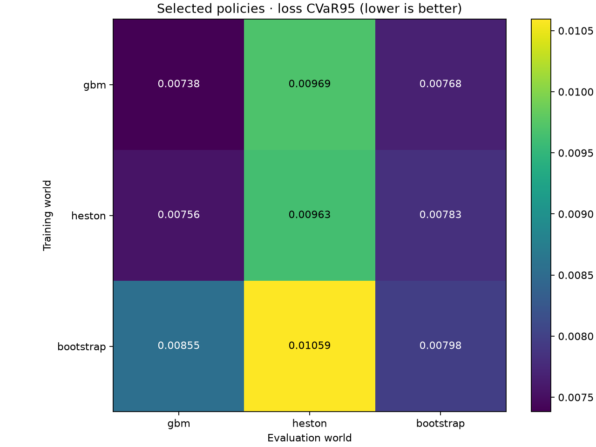
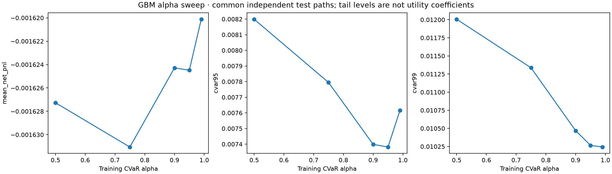
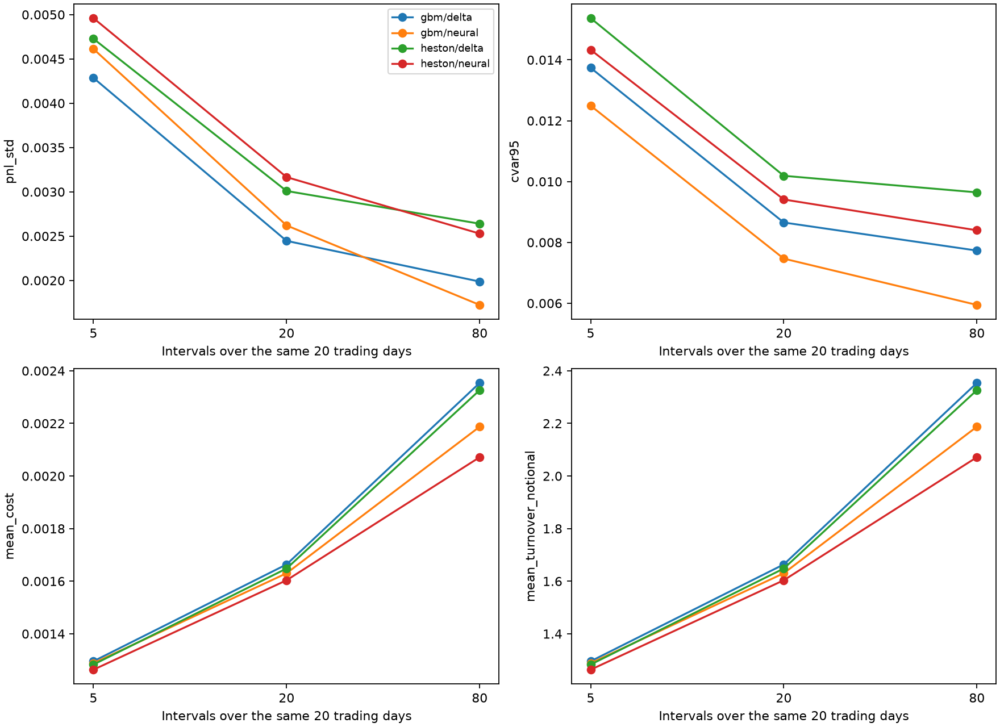
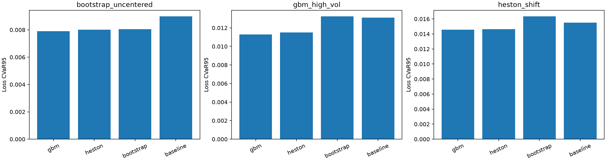

# Phase 5 robustness and misspecification report

All calibration uses daily NIFTY observations ending 30 June 2026. Validation uses 1 July–15 September; the empirical test-return library begins 16 September. These historical dates were already inspected in earlier research. The new sampled paths are synthetic and do not restore a pristine real-market holdout.

## Clock and calibration

The nominal horizon is 20 trading days with 20 daily steps. GBM volatility ranges come from training-only 20-day realized volatility. Heston uses a capped realized-variance AR(1) moment proxy, not an identified option-surface fit; pricing assumes zero variance risk premium. The estimated parameters are recorded without overriding an unexpected sign to fit a market narrative.

```json
{
  "sigma_low": 0.07391058026515042,
  "sigma_high": 0.20354908222956075,
  "kappa": 2.5756363885077813,
  "theta": 0.01714367406502151,
  "xi": 0.31633982483655915,
  "rho": 0.1858336507618193,
  "bootstrap_log_center": -9.861979545054668e-05,
  "training_rows": 266,
  "training_start": "2025-06-03",
  "training_end": "2026-06-30",
  "method": "20-day realized-variance AR(1) moment proxy, parameter caps predeclared; not identified option-surface Heston calibration",
  "risk_premium_assumption": "Zero volatility risk premium when using proxy parameters in Fourier premiums"
}
```

GBM uses BS premiums. Heston initial premiums use an audited Fourier grid; terminal payoff is exact. BS delta/gamma using observed current variance are proxy hedge features/baselines, not asserted optimal Heston hedges. Heston variance is directly observed in this simulated experiment, an oracle-information assumption.

Bootstrap samples three-day blocks within disjoint return libraries, uses a synthetic past 20-day prefix for strictly backward-looking realized volatility, and subtracts the training-only log moment. It is not an arbitrage-free model or a genuine 20-day historical trade backtest. Its initial premium is an explicitly shared BS reference quote. Held-out library drift/dependence may differ from training.

## Source-library coverage

| split | rows | start | end |
|---|---|---|---|
| train | 266 | 2025-06-03 | 2026-06-30 |
| validation | 54 | 2026-07-01 | 2026-09-15 |
| test | 30 | 2026-09-16 | 2026-10-29 |

Thousands of bootstrap simulations do not create thousands of independent historical return observations. Path-bootstrap confidence intervals condition on the fixed empirical library and exclude its estimation uncertainty.

## Cross-world comparison

| training_world | test_world | mean_net_pnl | pnl_std | cvar95 | cvar99 | mean_cost |
|---|---|---|---|---|---|---|
| gbm | gbm | -0.00162448 | 0.00263334 | 0.00738157 | 0.010266 | 0.00162494 |
| heston | gbm | -0.00160135 | 0.00263906 | 0.00755632 | 0.0105248 | 0.00160456 |
| bootstrap | gbm | -0.00156828 | 0.00340931 | 0.00855487 | 0.0112618 | 0.00155596 |
| gbm | heston | -0.00161144 | 0.0032479 | 0.00969379 | 0.0137739 | 0.00162948 |
| heston | heston | -0.00159324 | 0.00320998 | 0.00962977 | 0.0138058 | 0.00161006 |
| bootstrap | heston | -0.00154397 | 0.00391791 | 0.0105945 | 0.0146715 | 0.0015646 |
| gbm | bootstrap | -0.00162428 | 0.00276997 | 0.00768033 | 0.0100943 | 0.00167144 |
| heston | bootstrap | -0.00164025 | 0.00277431 | 0.00782708 | 0.0102654 | 0.00164557 |
| bootstrap | bootstrap | -0.0013891 | 0.00342627 | 0.00798108 | 0.010259 | 0.00158541 |



Each model is selected only on its own source-world validation. Source-tuned constant-band controls are retained in the comparison file; target-world validation-tuned baselines are reported separately as stronger target-informed benchmarks. No model is selected using the evaluation world’s test outcomes.

| world | strategy | mean_net_pnl | pnl_std | cvar95 |
|---|---|---|---|---|
| gbm | unhedged | 0.000144237 | 0.0265758 | 0.0715126 |
| gbm | delta | -0.00164779 | 0.00242562 | 0.00846284 |
| gbm | constant_band | -0.00143789 | 0.00254827 | 0.00816318 |
| gbm | whalley_wilmott | -0.00130122 | 0.00285304 | 0.00884576 |
| heston | unhedged | -3.02208e-05 | 0.0265991 | 0.0732838 |
| heston | delta | -0.00163173 | 0.00302383 | 0.0102686 |
| heston | constant_band | -0.00141147 | 0.00313719 | 0.0100703 |
| heston | whalley_wilmott | -0.00127451 | 0.00342632 | 0.0106721 |
| bootstrap | unhedged | 0.000776544 | 0.0243197 | 0.0606891 |
| bootstrap | delta | -0.00168955 | 0.00263995 | 0.00878236 |
| bootstrap | constant_band | -0.000937722 | 0.00285119 | 0.00749765 |
| bootstrap | whalley_wilmott | -0.000907606 | 0.00278315 | 0.00768778 |

## Alpha and rebalancing sweeps

| alpha | mean_net_pnl | pnl_std | cvar95 | cvar99 | objective_cvar |
|---|---|---|---|---|---|
| 0.5 | -0.00162727 | 0.00238669 | 0.00819872 | 0.0120059 | 0.00324849 |
| 0.75 | -0.00163106 | 0.00239244 | 0.00779486 | 0.0113364 | 0.00443512 |
| 0.9 | -0.00162429 | 0.0025202 | 0.00739861 | 0.0104684 | 0.00611226 |
| 0.95 | -0.00162448 | 0.00263334 | 0.00738157 | 0.010266 | 0.00738157 |
| 0.99 | -0.00162012 | 0.00289129 | 0.00761527 | 0.0102425 | 0.0102425 |





Frequency models are trained separately at 5, 20 and 80 intervals; evaluation uses nested common finest-grid paths. Daily bootstrap is not interpolated into invented intraday observations, so the fine-frequency comparison is limited to GBM/Heston.

## Stress tests



The predeclared shifts increase volatility, alter Heston dynamics and remove bootstrap recentering. Policies remain frozen. Failure or degradation is evidence about robustness, not a reason to change the held-out bank.

## Reproduction

`python src/run_phase5_research.py --daily DAILY_PARQUET --output NEW_DIRECTORY`

Read pricing_audits.json, return-pool files, experiment_plan.json, frozen_before_test.json, robustness_comparison.csv and verification.json for provenance. No prospective profitability, calibrated real-market uncertainty or global optimality is claimed.

## Volatility observability sensitivity

Frozen policies are re-evaluated on the same Heston paths after replacing latent variance by a training-range RMS prior until five past returns are observed, then trailing realized volatility. Initial latent variance is never used. Premium and terminal liability remain unchanged. This is a pre-test protocol correction, retained in supplemental_protocol_v2.json; no policy was refitted.

| training_world | information | mean_net_pnl | pnl_std | cvar95 | cvar99 |
|---|---|---|---|---|---|
| gbm | latent_variance | -0.00161144 | 0.0032479 | 0.00969379 | 0.0137739 |
| gbm | trailing_realized_proxy | -0.00164189 | 0.00349471 | 0.0106695 | 0.0155821 |
| heston | latent_variance | -0.00159324 | 0.00320998 | 0.00962977 | 0.0138058 |
| heston | trailing_realized_proxy | -0.00161964 | 0.00346202 | 0.0106251 | 0.015572 |
| bootstrap | latent_variance | -0.00154397 | 0.00391791 | 0.0105945 | 0.0146715 |
| bootstrap | trailing_realized_proxy | -0.0015695 | 0.00403191 | 0.0110224 | 0.0159097 |
| baseline | trailing_realized_proxy | -0.00165531 | 0.00340088 | 0.0115425 | 0.0171137 |

These are information-regime diagnostics, not a pure dynamics comparison. The main Heston policy has higher tail loss when latent variance is unavailable. The proxy-delta baseline uses the same proxy information.
