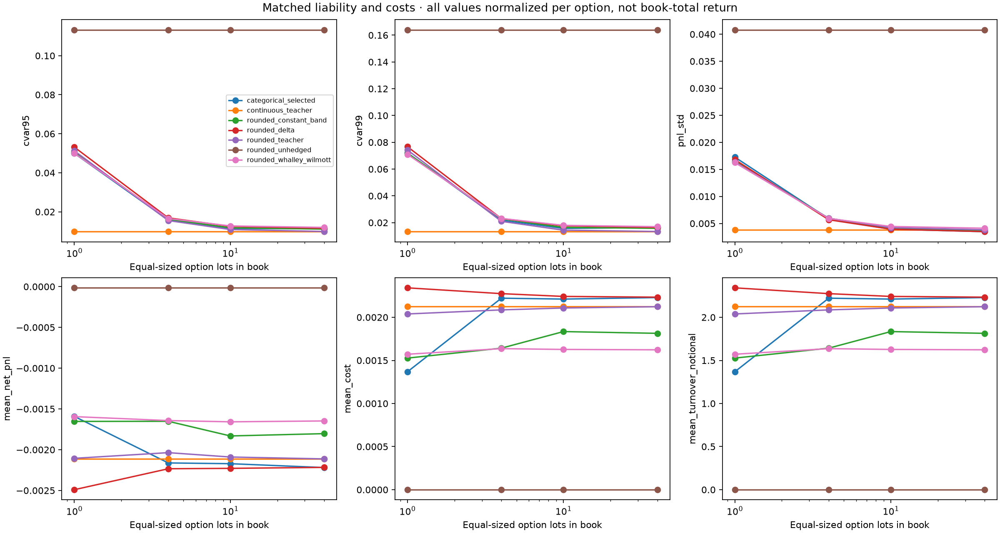

# Phase 7 matched rounding bridge

The continuous teacher, closed-loop rounded teacher, newly trained categorical policies and conventional baselines share the same short-option liability and common test paths. This is a synthetic granularity experiment; the older long-option/historical checkpoints are not reused for an incompatible liability.

Books contain 1, 4, 10 and 40 equal-sized option lots. Underlying units per hedge lot equal option units per option lot; normalized action grids have spacing 1/book. Half-lot ties go toward zero and upper capacity is floor(1.2*book)/book. This boundary effect is part of executable granularity.

Rounded policies observe their actual rounded previous inventory. Continuous execution trajectories are not rounded open-loop after the fact. All quantities, premium and costs normalize to one option, avoiding misleading improvement from changing book size. Total normalized book P&L can be obtained by multiplying per-option results by book size.

Categorical policies receive an explicit imitation warm start from the frozen continuous teacher, then CVaR policy-gradient training with a learned threshold. An imitation-only diagnostic is retained. The combined residual difference includes architecture and optimization effects plus the additional warm-start budget; it is not a causal estimate of algorithm quality alone. Model/seed selection uses validation only.

| book | label | mean_net_pnl | pnl_std | cvar95 | mean_cost |
|---|---|---|---|---|---|
| 1 | continuous_teacher | -0.00211283 | 0.00378989 | 0.0098407 | 0.00212629 |
| 1 | rounded_teacher | -0.00210601 | 0.0163775 | 0.0512485 | 0.00203888 |
| 1 | rounded_unhedged | -1.51696e-05 | 0.040813 | 0.113252 | 0 |
| 1 | rounded_delta | -0.0024905 | 0.0168093 | 0.0531427 | 0.00234178 |
| 1 | rounded_constant_band | -0.00165316 | 0.016525 | 0.0505746 | 0.00152684 |
| 1 | rounded_whalley_wilmott | -0.00159442 | 0.0162558 | 0.0499881 | 0.00157159 |
| 1 | categorical_selected | -0.00159178 | 0.0172722 | 0.0499614 | 0.00136812 |
| 4 | continuous_teacher | -0.00211283 | 0.00378989 | 0.0098407 | 0.00212629 |
| 4 | rounded_teacher | -0.00203624 | 0.00595425 | 0.0155373 | 0.00208609 |
| 4 | rounded_unhedged | -1.51696e-05 | 0.040813 | 0.113252 | 0 |
| 4 | rounded_delta | -0.0022338 | 0.0056899 | 0.0169127 | 0.0022746 |
| 4 | rounded_constant_band | -0.00165165 | 0.00597112 | 0.0162052 | 0.00164211 |
| 4 | rounded_whalley_wilmott | -0.0016429 | 0.00592766 | 0.0165617 | 0.00163638 |
| 4 | categorical_selected | -0.00216247 | 0.00585633 | 0.0158031 | 0.00222194 |
| 10 | continuous_teacher | -0.00211283 | 0.00378989 | 0.0098407 | 0.00212629 |
| 10 | rounded_teacher | -0.00208986 | 0.00423693 | 0.0109428 | 0.00210818 |
| 10 | rounded_unhedged | -1.51696e-05 | 0.040813 | 0.113252 | 0 |
| 10 | rounded_delta | -0.00222888 | 0.00393815 | 0.0125402 | 0.00224227 |
| 10 | rounded_constant_band | -0.0018315 | 0.00401391 | 0.0118231 | 0.00183443 |
| 10 | rounded_whalley_wilmott | -0.00165815 | 0.00444362 | 0.0127767 | 0.00162721 |
| 10 | categorical_selected | -0.00217175 | 0.00394189 | 0.0113679 | 0.00221136 |
| 40 | continuous_teacher | -0.00211283 | 0.00378989 | 0.0098407 | 0.00212629 |
| 40 | rounded_teacher | -0.00211293 | 0.00381839 | 0.00993481 | 0.00212331 |
| 40 | rounded_unhedged | -1.51696e-05 | 0.040813 | 0.113252 | 0 |
| 40 | rounded_delta | -0.00221693 | 0.00349017 | 0.0115861 | 0.0022338 |
| 40 | rounded_constant_band | -0.0018031 | 0.00372252 | 0.0111452 | 0.00181406 |
| 40 | rounded_whalley_wilmott | -0.00164744 | 0.00411641 | 0.0120153 | 0.00162297 |
| 40 | categorical_selected | -0.00221915 | 0.00348274 | 0.0115168 | 0.00222922 |

| book | strategy | reference | mean_pnl_difference | cvar95_difference | cvar95_lower95 | cvar95_upper95 |
|---|---|---|---|---|---|---|
| 1 | rounded_teacher | continuous_teacher | 6.82012e-06 | 0.0414078 | 0.0399198 | 0.0426775 |
| 1 | categorical_22 | rounded_teacher | 0.000514232 | -0.00128706 | -0.00293722 | 0.000227409 |
| 4 | rounded_teacher | continuous_teacher | 7.65957e-05 | 0.00569655 | 0.00539112 | 0.00598718 |
| 4 | categorical_11 | rounded_teacher | -0.000126234 | 0.000265858 | 8.23196e-07 | 0.000546436 |
| 10 | rounded_teacher | continuous_teacher | 2.29726e-05 | 0.0011021 | 0.000961747 | 0.0012304 |
| 10 | categorical_11 | rounded_teacher | -8.18923e-05 | 0.00042509 | 0.000230985 | 0.000638372 |
| 40 | rounded_teacher | continuous_teacher | -9.79217e-08 | 9.41075e-05 | 5.19211e-05 | 0.000133683 |
| 40 | categorical_11 | rounded_teacher | -0.000106216 | 0.00158201 | 0.00140096 | 0.00175926 |

These results exclude NIFTY basis, brokerage, SPAN margins, market depth and partial fills. They isolate granularity and matched-learning effects before any historical execution extension.

`python src/run_phase7_research.py --phase4 PHASE4_RUN --output NEW_DIRECTORY`
